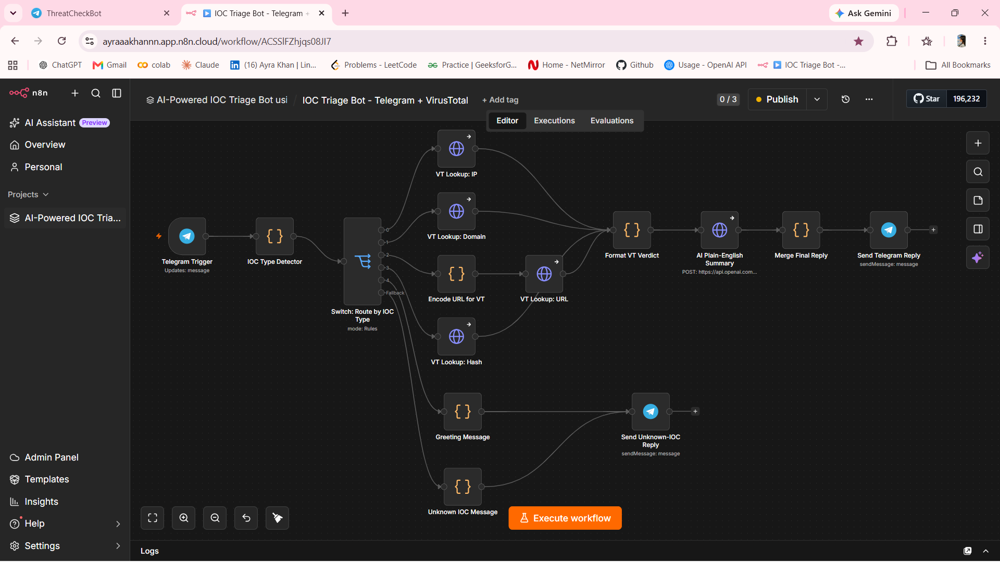
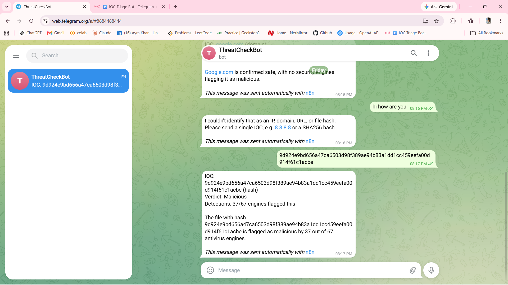
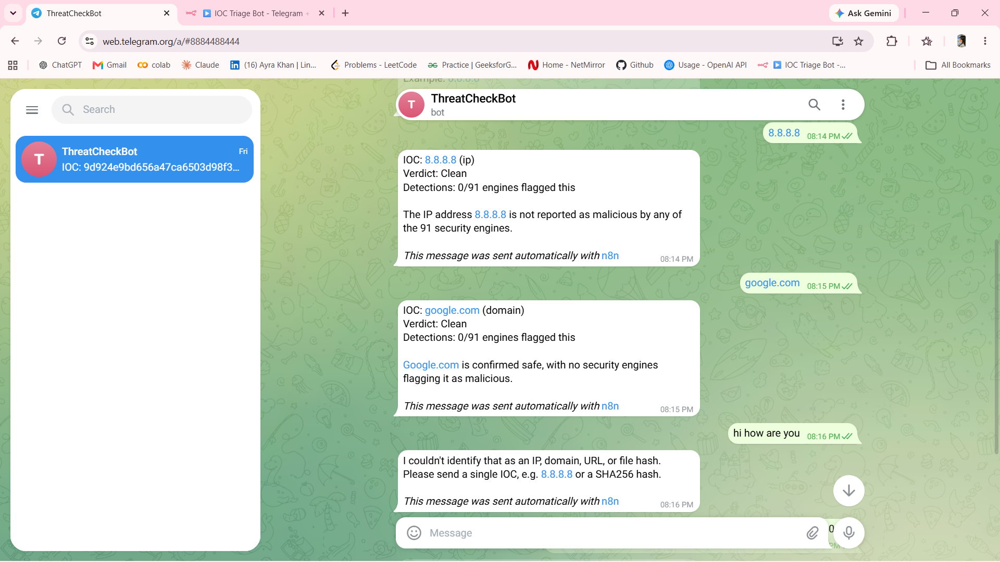

# IOC Triage Bot (n8n + Telegram + VirusTotal + OpenAI)

A Telegram bot that checks an IP, domain, URL or file hash against VirusTotal
and replies with a verdict and a plain-English summary.

## Demo

## How it works
Telegram Trigger → IOC Type Detector → Switch (IP / Domain / URL / Hash / Greeting / Unknown)
→ VirusTotal lookup → Format Verdict → OpenAI summary → Merge Reply → Telegram reply

- **IOC Type Detector** uses regex to classify the message.
- **VirusTotal API v3** returns how many engines flagged the IOC.
- **Verdict rules:** 5+ malicious = Malicious, 1-4 = Suspicious, 0 = Clean.
- **OpenAI (gpt-4o-mini)** writes a short summary for non-experts.

## Setup
1. Import `ioc-triage-bot-workflow.json` into n8n.
2. Create these credentials:
   - **Telegram:** bot token from @BotFather
   - **VirusTotal:** Header Auth, name `x-apikey`, value = your key
   - **OpenAI:** Header Auth, name `Authorization`, value = `Bearer sk-...`
3. Select the credentials in each node, then Publish the workflow.
4. Message your bot an IOC, for example `8.8.8.8`.

## Example
Input: `44d88612fea8a8f36de82e1278abb02f`
Output: Verdict Malicious, 66/68 engines flagged.

## Tech
n8n, Telegram Bot API, VirusTotal API v3, OpenAI API
